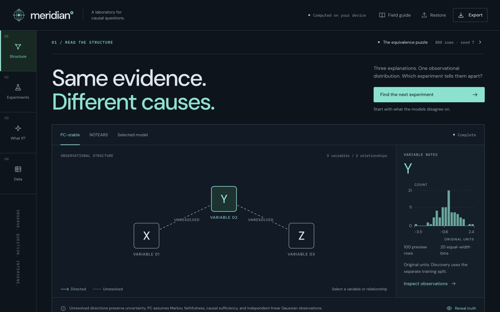
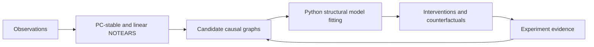

# Meridian

A local causal machine learning laboratory for discovery, competing explanations, interventions, and counterfactuals under an explicit structural model.

[](pyproject.toml)
[](LICENSE)
[](https://dhanushkrishna4.github.io/Meridian/)

[Live demo](https://dhanushkrishna4.github.io/Meridian/) · [Documentation](#documentation) · [Validation](#validation-and-results) · [License](#license)



## Highlights

- **Inspect ambiguity:** replay PC-stable's independence tests and orientation trace, compare a linear NOTEARS candidate, and explore consistent DAG extensions.
- **Choose an experiment:** rank interventions using disagreement in predicted means and covariances; collect simulated or imported measured batches.
- **Ask what changes:** compare conditioning, interventions, and row-specific counterfactuals under the selected structural causal model (SCM).
- **Keep analysis local:** the Python engine runs natively or in a Pyodide worker behind a static React interface. No analysis server, API key, or cloud compute is required. Uploaded CSVs stay in the browser; raw-data persistence is opt-in.
- **Reproduce an investigation:** inspect seeded worlds, recorded splits, and diagnostics; export or restore fitted models and evidence.

## How it works



1. **Observe:** choose a seeded world or load 2–15 complete numerical CSV columns, with 20–5,000 rows and a 5 MiB limit.
2. **Discover:** PC-stable records separating sets and orientation premises; NOTEARS supplies a separately optimized candidate.
3. **Compare:** enumerate up to 128 consistent DAG extensions, explicitly label truncation, and fit candidates using training observations.
4. **Intervene:** replace structural equations, rank experiments, and update fixed-candidate plug-in likelihood support once per evidence batch.
5. **Ask what if:** abduct an observed row's residuals, intervene, and predict under the selected SCM.

The default puzzle has three observationally equivalent DAGs. Their covariances agree, but `do(Y=1)` predicts different `(X,Z)` means: `(0,.8)`, `(.8,0)`, and `(.8,.8)`. Covariances still differ at `do(Y=0)`. The learner estimates parameters from observations, never fixture coefficients or simulator truth.

Graph algorithms, PC-stable, linear NOTEARS, structural fitting, causal queries, and campaign logic are implemented in [`src/meridian_causal`](src/meridian_causal). NumPy and SciPy supply numerical primitives, optimization, and matrix exponentials. External reference implementations are development-only comparisons. The frontend presents Python results.

## Run locally

The package requires Python 3.12 or newer. The recorded native environment uses Python 3.14.3, NumPy 2.4.2, and SciPy 1.17.1. Use Node 22 or newer and system `curl` for the website build.

```sh
python3 -m venv .venv
.venv/bin/python -m pip install -r requirements-dev.txt
.venv/bin/python -m pip install --no-deps --no-build-isolation .
npm --prefix web ci
npm --prefix web run dev
```

Open the printed HTTP address. First-time preparation downloads roughly 35 MiB of pinned browser assets; later builds verify and reuse them. The browser uses Pyodide 0.27.7, Python 3.12.7, NumPy 2.0.2, and SciPy 1.14.1. SciPy loads on demand for NOTEARS.

From the repository root, use the installed CLI:

```sh
.venv/bin/meridian demo --output examples/campaign.json
.venv/bin/meridian fixture --output examples/exact-fixture.json
.venv/bin/meridian discover examples/observations.csv --columns X Y Z --output /tmp/meridian-csv.json
```

After changing Python source, repeat the package installation or run directly with `PYTHONPATH=src .venv/bin/python -m meridian_causal.cli fixture`. Tests and browser asset preparation already use checkout sources. The [examples guide](examples/README.md) explains the fixtures, campaign, and sample CSV.

## Validation and results

These are recorded results, not fresh test runs:

| Layer | Recorded evidence |
|---|---|
| Native engine | 159 tests passed with optional references enabled in the 2026-10-18 redesign record. Deployment CI passed 154 and skipped 5 optional checks. |
| Independent comparisons | Nine reference tests passed: 240 Fisher-Z comparisons, four PC fixtures, and three NOTEARS support comparisons. |
| Browser engine | 18/18 checks passed locally for the redesign. The initial release separately passed 18 hosted checks; that earlier run does not verify the redesigned interface. |
| Bounded evaluation | 108 discovery runs, six paired experiment campaigns, and six hidden-confounder cases, including retained failures. |

To reproduce the native suite and production browser harness:

```sh
# From the repository root
.venv/bin/python -m pytest -q
PYTHONPATH=src .venv/bin/python scripts/generate_fixtures.py
npm --prefix web run build
python3 scripts/serve_production.py --port 4173
```

Open `http://127.0.0.1:4173/Meridian/verification.html`, run the checks, and download the report. [Evaluation instructions](docs/EVALUATION.md) cover optional references and benchmark reproduction. Build native distribution archives with `.venv/bin/python -m build --no-isolation`; the wheel contains the engine and CLI, while the website is built separately.

## Scope and limitations

- Supported models are small acyclic **linear Gaussian additive-noise** systems with continuous variables and complete independent observations. PC's causal interpretation additionally assumes causal Markov, faithfulness, and causal sufficiency.
- Observations generally do not identify a unique DAG. PC uses first-separating-set orientation, stable variable-ID ordering, conflict-checked Meek R1–R3, and structural CPDAG validation; it is not conservative PC or FCI. NOTEARS directions are model choices, not causal proof.
- P-values are not edge probabilities; bootstrap frequencies measure stability; effect intervals condition on the selected graph. Plug-in likelihood weights are not calibrated Bayesian causal posteriors. Truncated enumeration is not a complete identified set.
- The benchmark uses only three sparse graph structures. Four standardized NOTEARS runs failed numerically and remain recorded. Results do not establish broad recovery, method superiority, or optimal experiment selection.
- Hidden confounding is an explicit simulator assumption violation, not an automatically detected condition. Nonlinear identification, missing data, time series, and unrestricted do-calculus are outside scope.
- The redesigned site's final hosted interaction pass and several visible controls remain unverified. Safari, Firefox, physical touch devices, comprehensive accessibility, and browser memory usage were not validated. See the [precise remaining checks](docs/redesign/DESIGN.md#remaining-verification-limits).

## Documentation

| Guide | Contents |
|---|---|
| [Architecture](docs/ARCHITECTURE.md) | Python/browser boundary, state, and recovery |
| [PC and graphs](docs/PC.md) · [NOTEARS](docs/NOTEARS.md) | Algorithms, conventions, and implementation boundaries |
| [SCMs and experiments](docs/SCM.md) | Conditioning, interventions, counterfactuals, and evidence |
| [Evaluation](docs/EVALUATION.md) · [Verification](docs/VERIFICATION.md) | Reproduction commands, measured results, and failure accounting |
| [Redesign record](docs/redesign/DESIGN.md) · [Deployment record](docs/DEPLOYMENT.md) | Dated interface and publication evidence |

## Deployment

[GitHub Actions](.github/workflows/pages.yml) runs core tests, builds the static site, and publishes `web/dist` to [GitHub Pages](https://dhanushkrishna4.github.io/Meridian/) after a push to `main` or manual dispatch. It does not rerun benchmarks on every deployment. Runtime assets are bundled; inference still runs locally in the visitor's browser.

Serve production output over HTTP, never `file://`. The server above preserves `/Meridian/`. Publication and browser verification are recorded separately in [DEPLOYMENT.md](docs/DEPLOYMENT.md).

## License

Meridian is licensed under the [MIT License](LICENSE). Dependencies and bundled assets retain their own licenses; see [third-party notices](THIRD_PARTY_NOTICES.md).
